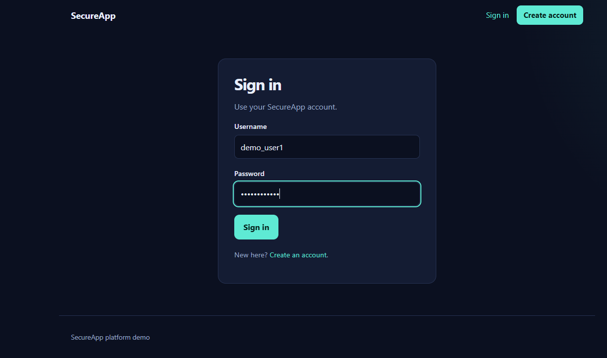
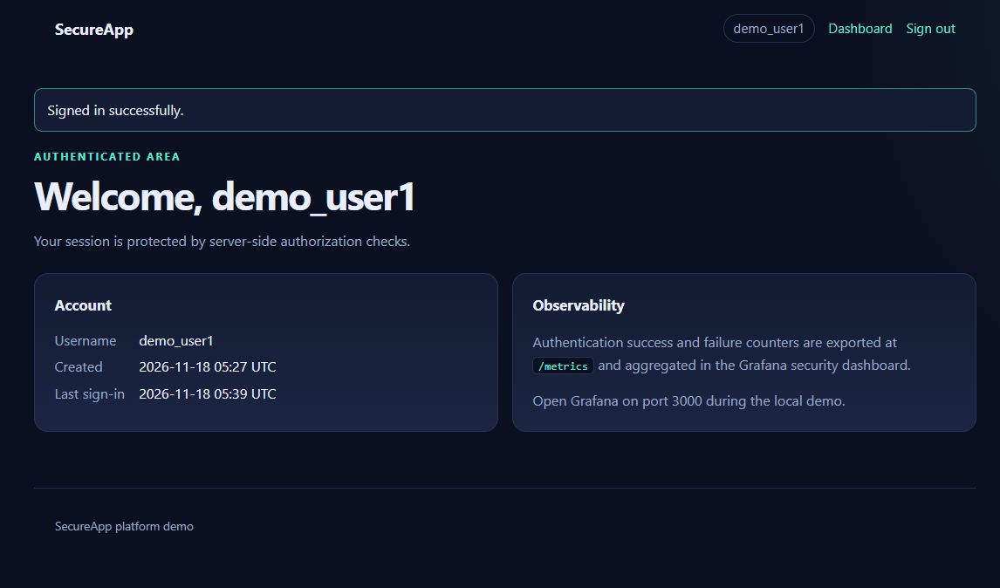
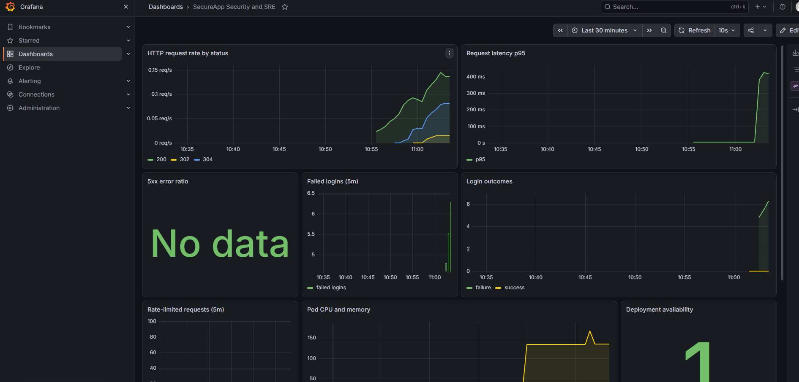
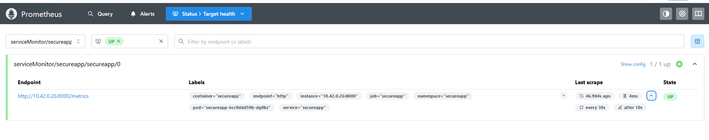

# SecureApp Platform

SecureApp is a small Flask application for practising secure delivery. It has registration and login, runs on Kubernetes, and exports metrics that Prometheus collects and Grafana displays. A GitHub Actions pipeline tests it, scans it, builds the image, and publishes release artifacts.

The app is deliberately small. It uses SQLite on a persistent volume, runs one replica, and is reached with `kubectl port-forward`. There is no ingress, registry, or external database. That keeps the demo light enough for a laptop and makes the delivery and monitoring pieces easier to see.

## What is included

- Registration and login with scrypt password hashes, CSRF protection, generic login errors, safe redirects, and rate limits.
- Security headers, JSON audit logs, and Prometheus counters for login outcomes, rate limiting, and access denials.
- GitHub Actions checks for tests, secrets, static analysis, dependency vulnerabilities, and container vulnerabilities.
- A Kubernetes deployment with a non-root user, read-only root filesystem, dropped capabilities, no service-account token, resource limits, RBAC, and default-deny networking.
- A Prometheus `ServiceMonitor` and a Grafana dashboard for request, error, login, rate-limit, and pod signals.

## Screenshots

| Sign in | Signed-in dashboard |
| --- | --- |
|  |  |

| Grafana dashboard | Prometheus target |
| --- | --- |
|  |  |

The rest, including the rate-limit page, Kubernetes resources, and CI evidence, are in [docs/screenshots](docs/screenshots/README.md).

## How it fits together

```text
source code
    |
    v
GitHub Actions
  test -> secret scan -> SAST -> dependency audit
                                |
                                v
                       build + Trivy scan + SBOM
                                |
                                v
                          k3d / k3s cluster
                          +------------------+
                          | secureapp        |
                          | Flask + SQLite   |
                          | RBAC + netpol    |
                          +---------+--------+
                                    |
                          ServiceMonitor :8000/metrics
                                    |
                                    v
                         Prometheus -> Grafana
```

Images are imported directly into k3d. Tagged releases attach the compressed image, SBOM, SARIF report, and checksums to the GitHub Release.

## Repository layout

```text
app/
  secureapp/            Flask package
  tests/                pytest suite
  Dockerfile            Python 3.12 runtime image
  requirements*.txt
deploy/k8s/             namespace, RBAC, NetworkPolicy, PVC, Deployment, Service
monitoring/             Helm values, ServiceMonitor, Grafana dashboard
security/               Bandit, Semgrep, and git-secrets configuration
scripts/                local cluster, deployment, monitoring, and secret helpers
docs/                   design notes, runbook, demo steps, evaluation
.github/workflows/ci.yml
```

## Run the app locally

You need Python 3.12 or newer, pip, and a POSIX shell. The tests in this repo were run with Python 3.14.4.

```bash
make venv
make test

cd app
SECRET_KEY="$(openssl rand -hex 32)" ../.venv/bin/flask --app wsgi run --host 127.0.0.1 --port 8000
```

Open <http://127.0.0.1:8000> and create an account. Passwords need at least 12 characters.

Current test result: **18 passed**, with **92.95%** statement coverage. CI fails below 80%.

### Run the container

```bash
docker build --pull -t secureapp:dev app

docker run --rm -p 8080:8000 \
  --read-only --tmpfs /tmp:size=16m \
  -e SECRET_KEY="$(openssl rand -hex 32)" \
  -e DATABASE_URL=sqlite:////tmp/app.db \
  secureapp:dev
```

The image runs as UID/GID 10001. Health, readiness, and metrics are available at `/healthz`, `/readyz`, and `/metrics`.

## Run the Kubernetes demo

You need Docker, k3d, kubectl, Helm, jq, openssl, and curl. The full stack, including monitoring, needs roughly 3 GB of RAM.

```bash
# Create the cluster, build and import the image, apply the manifests
make deploy

# Install Prometheus, Grafana, and the dashboard
make monitoring

# Forward the ports in separate terminals
kubectl -n secureapp port-forward svc/secureapp 8080:80
kubectl -n monitoring port-forward svc/monitoring-grafana 3000:80
kubectl -n monitoring port-forward svc/monitoring-kube-prometheus-prometheus 9090:9090
```

Application: <http://127.0.0.1:8080>

Grafana: <http://127.0.0.1:3000>. The user is `admin`.

```bash
kubectl -n monitoring get secret grafana-admin -o jsonpath='{.data.admin-password}' | base64 -d
```

The app secret is written to `deploy/k8s/secret.yaml`. That file is gitignored and should not be committed.

To put data on the dashboard, register a user, sign in, and try a few wrong passwords. The login limit is five POST requests per minute per client. The dashboard shows request rate, p95 latency, 5xx ratio, failed logins, login outcomes, rate-limited requests, pod CPU and memory, deployment availability, and container restarts.

Useful commands:

```bash
make logs
make cluster-down
kubectl -n secureapp get pods,svc,pvc,networkpolicy,serviceaccount
kubectl -n secureapp get events --sort-by=.lastTimestamp
```

## CI pipeline

The workflow in `.github/workflows/ci.yml` runs on pushes and pull requests to `main` and `prod`, and on `v*` tags.

| Job | What it does |
| --- | --- |
| `test` | Ruff and pytest, with an 80% coverage floor |
| `secret-scan` | git-secrets over the full history |
| `sast` | Semgrep and Bandit, with SARIF upload |
| `deps` | pip-audit against runtime requirements |
| `build-scan` | Builds the image, scans it with Trivy, creates an SBOM and image artifact |
| `deploy-smoke` | Deploys to a temporary k3d cluster on `main`/`prod` pushes and checks health, login, headers, and metrics |
| `monitoring-validate` | Renders the Helm chart and Kustomize output, and validates the dashboard JSON |
| `release` | On a `v*` tag, attaches the image, SBOM, SARIF, and checksums to the release |

No repository secrets are needed. The workflow uses `GITHUB_TOKEN`. The repository is public so GitHub can display code-scanning results.

Security scanners run in CI rather than in local hooks. Local work uses pytest, Ruff, Docker, k3d, and Helm.

## Configuration

| Variable | Default | Notes |
| --- | --- | --- |
| `SECRET_KEY` | Random in development; required in production | Used to sign sessions |
| `DATABASE_URL` | `sqlite:///app.db` | Kubernetes uses `sqlite:////data/app.db` |
| `APP_ENV` | `development` | `production` requires `SECRET_KEY` |
| `COOKIE_SECURE` | `false` | Set to `true` when serving over HTTPS |
| `LOG_LEVEL` | `INFO` | Controls JSON log output |
| `RATELIMIT_STORAGE_URI` | `memory://` | Per-process storage; limits are approximate across workers |

## Security notes

The app has CSRF protection, secure cookie settings, generic login failures, scrypt password hashes, and a login redirect check that rejects external, protocol-relative, and backslash targets. It also sets a content security policy and the usual frame, MIME, referrer, and permissions headers. HSTS is added when Flask sees an HTTPS request.

The pod runs as a non-root user with a read-only root filesystem, dropped capabilities, and the RuntimeDefault seccomp profile. The service account token is disabled. A default-deny NetworkPolicy allows monitoring to scrape port 8000 and allows DNS lookups. A separate `secureapp-deployer` Role exists for deployment tasks.

The runtime image removes pip and setuptools after dependencies are installed, partly to reduce the package surface and partly to keep the image scanner output clean.

## Known limits

- SQLite and one replica mean there is no horizontal scaling or database failover.
- There is no TLS or ingress in the demo. `COOKIE_SECURE` stays `false`.
- There is no MFA, email verification, password reset, or account lockout.
- Rate limiting is in memory and per worker.
- Prometheus keeps six hours of local data. There is no Alertmanager, Loki, or long-term storage.
- There is no container registry, Terraform, cloud deployment, or continuous delivery to a permanent cluster.
- The GitHub deployment check is a smoke test, not a production release process.

## Documentation

- [OWASP notes](docs/OWASP.md)
- [Threat model](docs/THREAT_MODEL.md)
- [Runbook](docs/RUNBOOK.md)
- [Demo steps](docs/DEMO.md)
- [Evaluation notes](docs/EVALUATION.md)
- [Screenshot list](docs/screenshots/README.md)

## License

MIT. See [LICENSE](LICENSE).
