# Screenshots

These images were captured from the local k3d demo and the GitHub Actions run. The commands behind them are in [../DEMO.md](../DEMO.md).

## Application

### Sign in

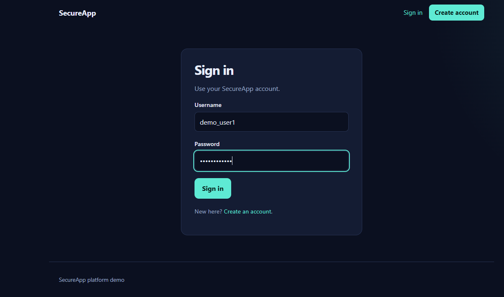

### Signed-in dashboard

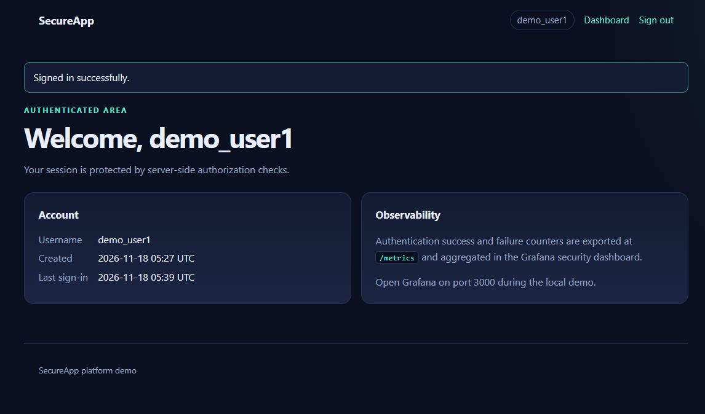

### Landing page

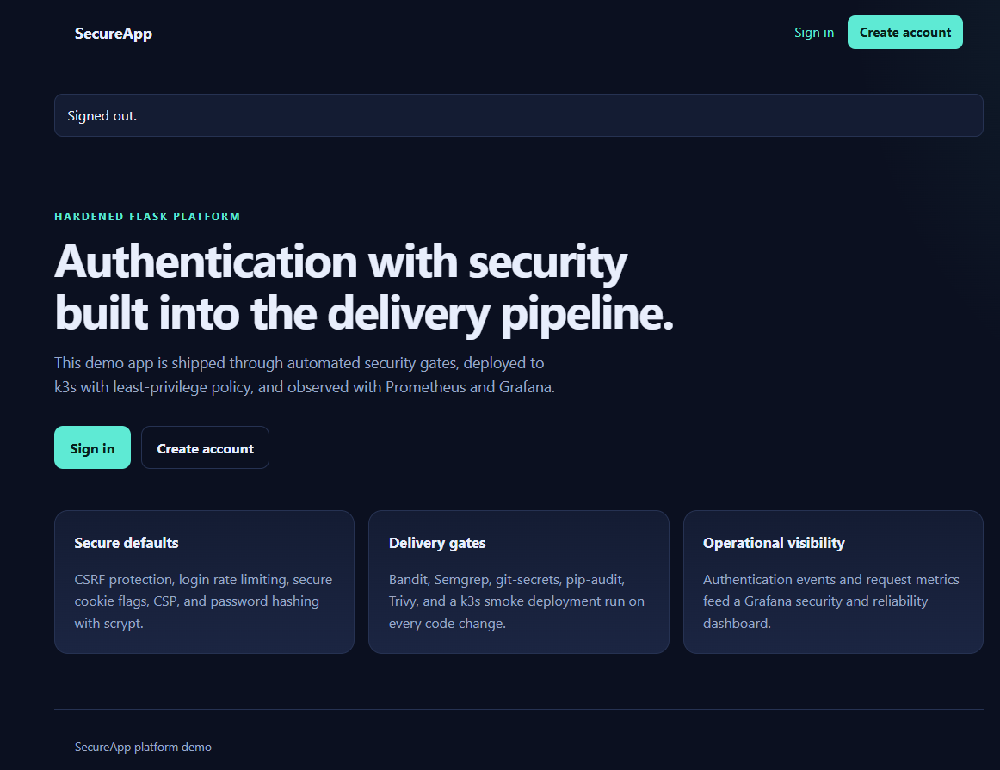

### Rate limit

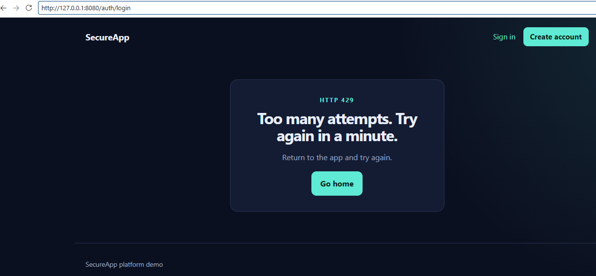

## Monitoring

### SecureApp Grafana dashboard

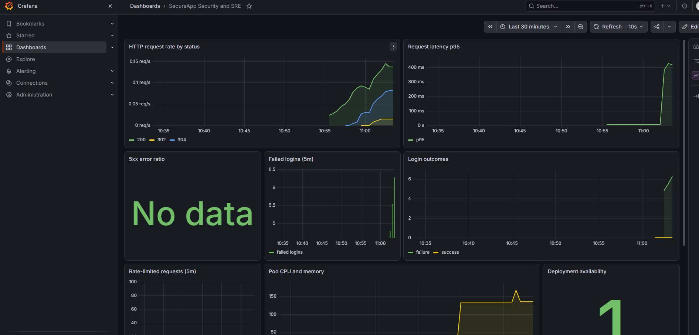

### Prometheus SecureApp target

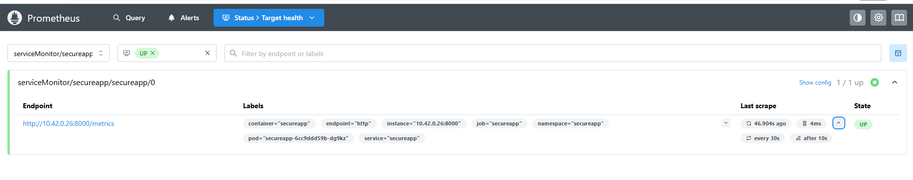

### Prometheus overview

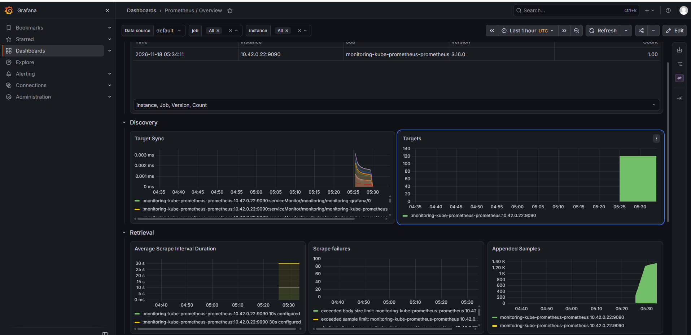

### All Prometheus targets

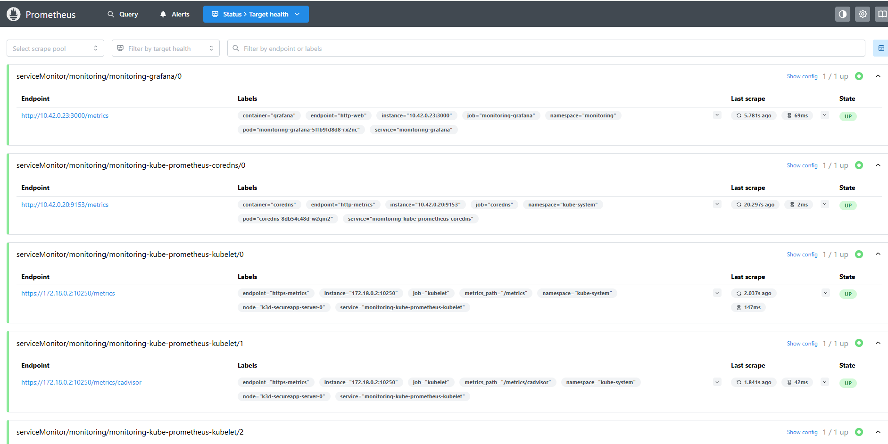

### Grafana overview

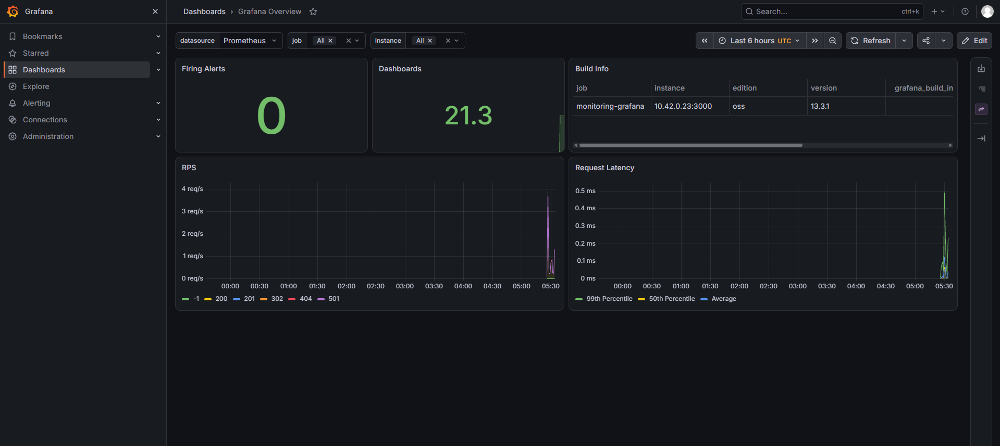

## Kubernetes

### Pods, services, storage, policies, and accounts

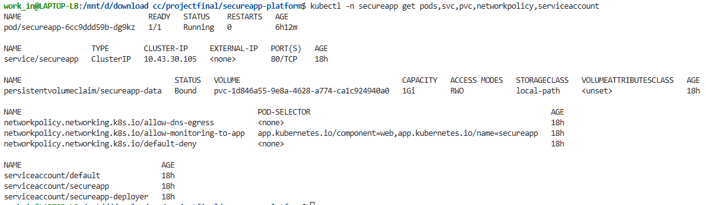

### Networking

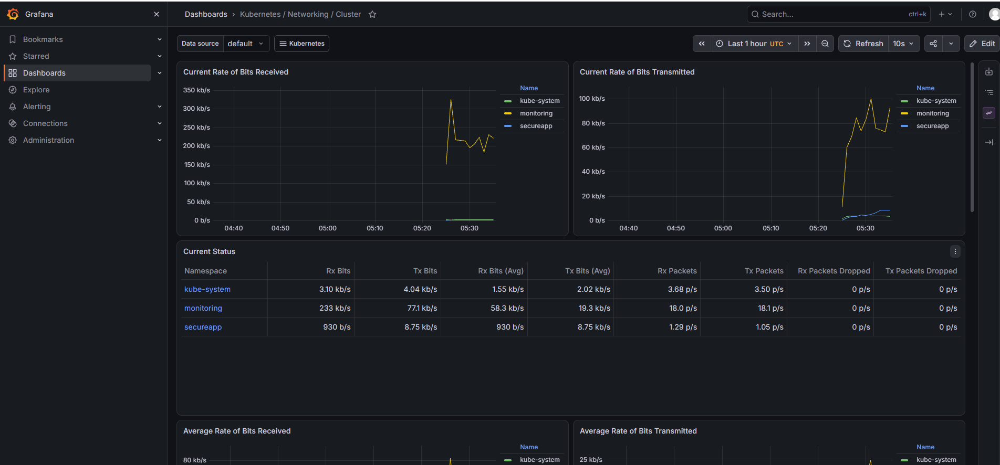

### Kubelet

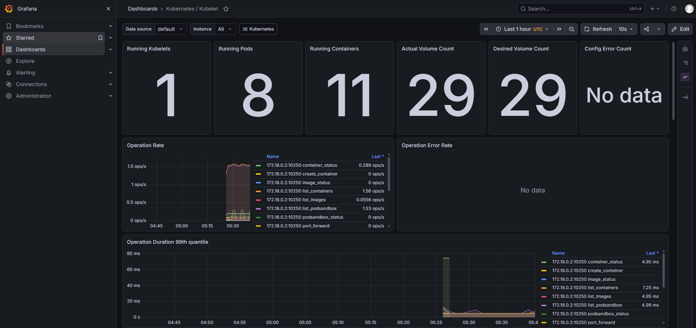

### Storage

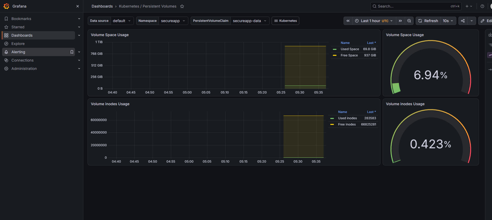

## GitHub Actions

### Successful CI run

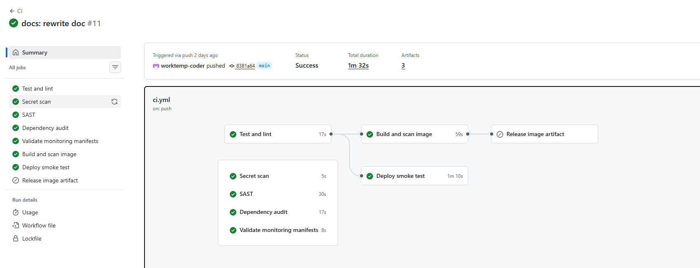

The release job is skipped on `main`. It runs only for `v*` tags.

### Artifacts

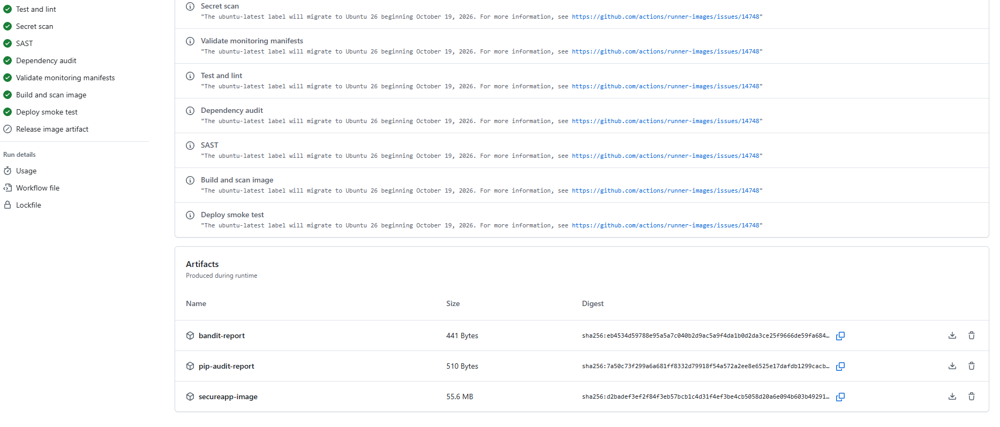

### Pull request checks

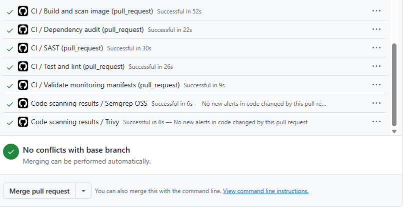
